# Индексы в MySQL. Практическое руководство (с ведением лога)

> **Это задание выполнять строго в WSL!**

**Цель:** научиться создавать индексы, читать план выполнения запроса (`EXPLAIN`) и понимать, когда индекс работает, а когда — нет.

**План руководства:**

1. Посмотреть, какие индексы уже есть в таблице `orders` (`SHOW INDEX`).
2. Выполнить `EXPLAIN` для запроса без индекса — увидеть `full scan`.
3. Создать индекс `CREATE INDEX` и повторить `EXPLAIN`.
4. Сравнить `type` и `rows`.
5. Убедиться, что функция в `WHERE` ломает индекс (`YEAR(order_date)`), и переписать запрос.
6. Дополнительно: составной и покрывающий индексы.
7. Научиться вести и экспортировать лог действий пользователя.

---
## Создайте новый контейнер

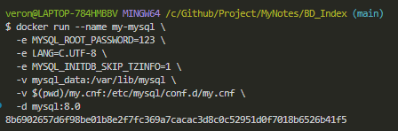

## Проверьте что контейнер запущен

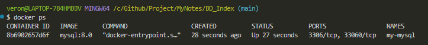

## Очистите лог перед началом работы

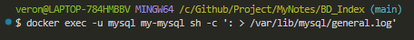

## Подключение к MySQL

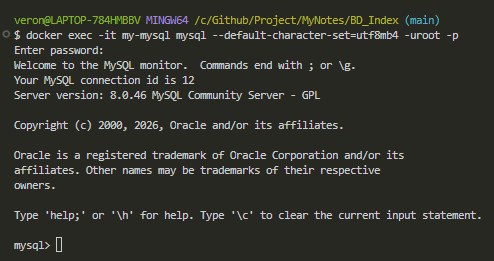

## Создание базы index_practice и таблиц

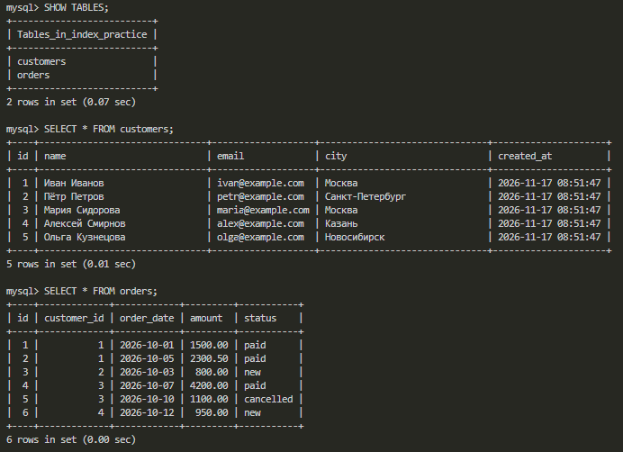

## Кратко: что такое индекс
Индекс — это отдельная структура (B-дерево), которая хранит отсортированные значения столбца и указатели на строки. Без индекса MySQL просматривает все строки (full scan). С индексом — прыгает сразу к нужным.

Главное правило: индекс ускоряет чтение, но замедляет запись (каждый INSERT/UPDATE обновляет все индексы). Не индексируйте «на всякий случай».

---

## Эксперимент 1: какие индексы уже есть
Вы увидите примерно такую картину:

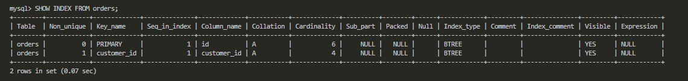

## ксперимент 2: EXPLAIN до индекса

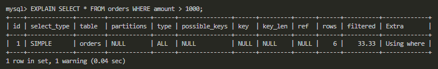

## Эксперимент 3: CREATE INDEX и EXPLAIN после

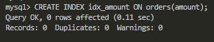

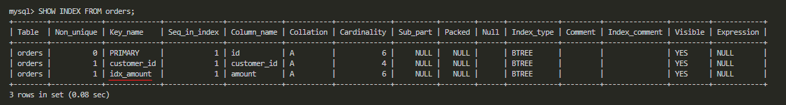

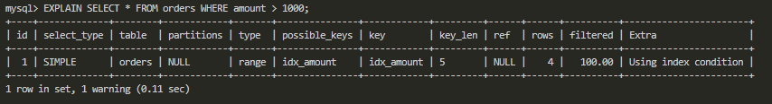

## Эксперимент 4: функция в WHERE ломает индекс

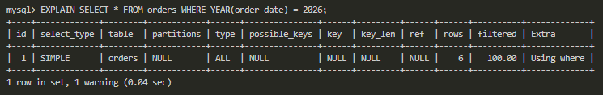


Создадим индекс по order_date

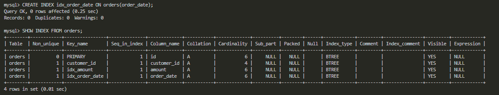

Перепишем запрос без функции

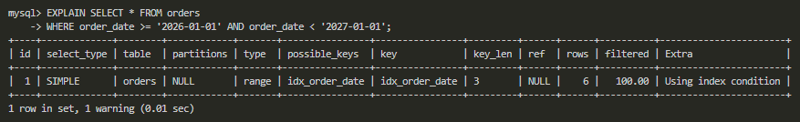

Вывод: type: range, key: idx_order_date — индекс используется. Функция убрана, условие переписано в виде диапазона.

Правило: если в WHERE есть функция над столбцом (YEAR(), MONTH(), DATE(), LOWER() и т.д.) — индекс не используется. Переписывайте запрос без функции.

## Эксперимент 5: составной индекс

Порядок столбцов в составном индексе критичен. Индекс (status, amount) работает для WHERE status = ... и WHERE status = ... AND amount > ..., но не для WHERE amount > ... без status.

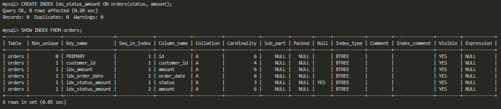

Проверим три запроса:

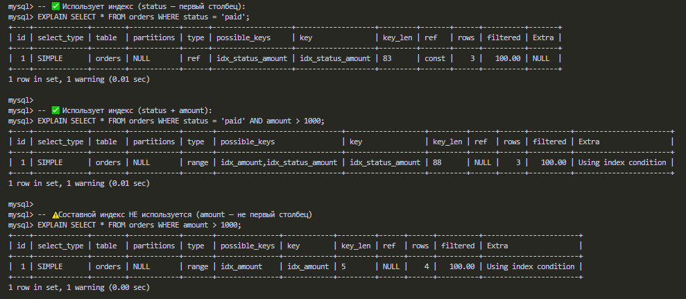

Важно: в третьем запросе MySQL не будет использовать idx_status_amount, но может использовать idx_amount, созданный ранее в разделе 6. Чтобы увидеть поведение именно составного индекса, временно удалите idx_amount:

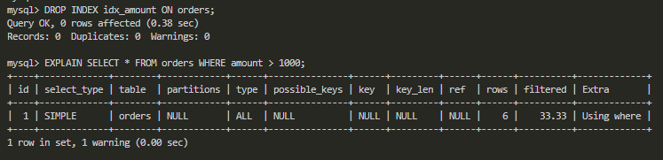

Теперь type будет ALL или index (полный просмотр), key — NULL или другой индекс. Составной idx_status_amount для этого запроса не подходит.

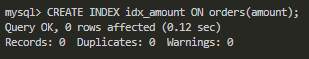

Как выбрать порядок:

Столбец с наибольшей селективностью — первым.
Столбцы из WHERE — в начало.
Столбцы из ORDER BY — в конец (если не конфликтуют).

## Эксперимент 6: покрывающий индекс

Если индекс содержит все столбцы, которые нужны запросу, MySQL не обращается к таблице. Это называется Index-Only Scan. В EXPLAIN в столбце Extra появляется Using index.

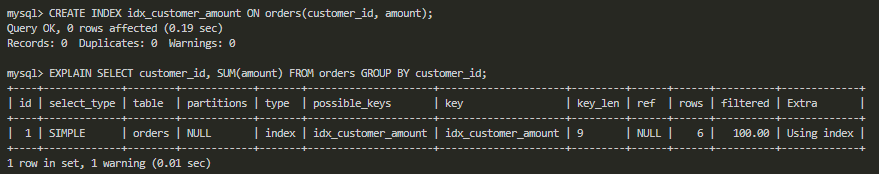

## Итоговая шпаргалка по `EXPLAIN`

| `type` | Что значит | Хорошо/плохо |
|--------|------------|--------------|
| `ALL` | Full scan — просмотр всех строк | ❌ Плохо |
| `index` | Полный просмотр индекса (может быть быстрее `ALL`, если индекс содержит нужные столбцы) | ⚠️ Средне |
| `range` | Диапазонный поиск по индексу | ✅ Хорошо |
| `ref` | Точечный поиск по индексу | ✅ Хорошо |
| `eq_ref` | Уникальный поиск (по PK или UNIQUE) | ✅ Отлично |
| `const` | Константа (одна строка) | ✅ Идеально |

| `Extra` | Что значит | Хорошо/плохо |
|---------|------------|--------------|
| `Using index` | Покрывающий индекс, таблица не читается | ✅ Отлично |
| `Using where` | Фильтрация после чтения | ⚠️ Нормально |
| `Using filesort` | Сортировка после чтения | ⚠️ Может быть медленно |
| `Using temporary` | Временная таблица | ❌ Плохо |

**Что дальше:** в MySQL 8.0.18+ есть `EXPLAIN ANALYZE` — он показывает **реальное** время выполнения каждого шага, а не оценку. Попробуйте:

```sql
EXPLAIN ANALYZE SELECT * FROM orders WHERE amount > 1000;
```

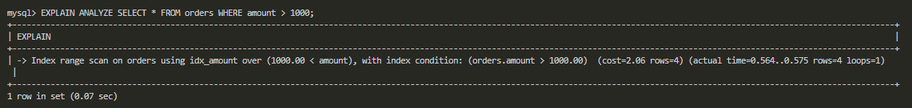

## Ведение и экспорт лога действий пользователя

