# Основные SQL-операции на примере двух таблиц «products 1» и «products 2»

Все команды и запросы можно выполнить в любом клиенте **MySQL 8.0.31+** (в Docker-контейнере). Для MySQL 8.0.31+ доступны операторы `EXCEPT` и `INTERSECT`; для более старых версий даны альтернативы.

---

[Задание выполняется по аналогии с БД **sql_practice**](/content/Courses/Basics_database_design/content/bd/MySQL.md)

## Создание базы данных

Получить список текущих контейнеров
```shell
docker ps -a
```
Остановить контейнер
```shell
docker stop имя_контейнера
```
Удаление всех остановленных контейнеров
```shell
docker container prune
```
Выполните очистку томов в Docker от предыдущих проектов:
```shell
docker volume prune -a
```

- Создайте отдельный каталог `products-mysql` (`mkdir products-mysql`) и перейдите в него (`cd products-mysql`).
- Создайте в каталоге `products-mysql` файл `my.cnf` (для корректного отображения кириллицы) с содержимым:
```shell
[mysqld]
character-set-server = utf8mb4
collation-server = utf8mb4_unicode_ci

[client]
default-character-set = utf8mb4

[mysql]
default-character-set = utf8mb4
```
Контейнер с официального образа **MySQL**:
```bash
docker run --name products-mysql \
  -e MYSQL_ROOT_PASSWORD=123 \
  -e LANG=C.UTF-8 \
  -v mysql_data:/var/lib/mysql \
  -v $(pwd)/my.cnf:/etc/mysql/conf.d/my.cnf \
  -d mysql:latest
```
Чтобы убедиться, что контейнер успешно запущен, выполните:
```bash
docker ps
```
Войти в контейнер с БД
```bash
docker exec -it products-mysql mysql --default-character-set=utf8mb4 -uroot -p
```
Создать новую БД
```sql
CREATE DATABASE shop
  CHARACTER SET utf8mb4
  COLLATE utf8mb4_unicode_ci;

USE shop;
```
Проверить результат
```sql
SHOW DATABASES;
```

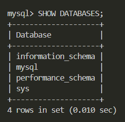

# Создание таблиц
```sql
CREATE TABLE products1 (
    name  VARCHAR(100) NOT NULL,
    price INT NOT NULL
) CHARACTER SET utf8mb4 COLLATE utf8mb4_unicode_ci;

CREATE TABLE products2 (
    name  VARCHAR(100) NOT NULL,
    price INT NOT NULL
) CHARACTER SET utf8mb4 COLLATE utf8mb4_unicode_ci;
```
Проверить результат
```sql
SHOW DATABASES;
SHOW TABLES;
```


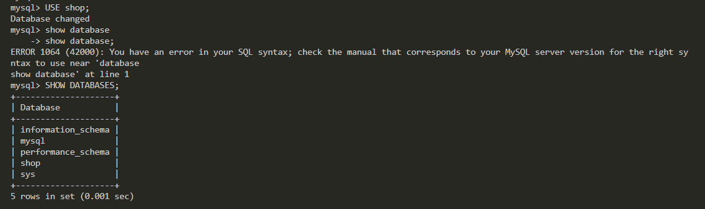

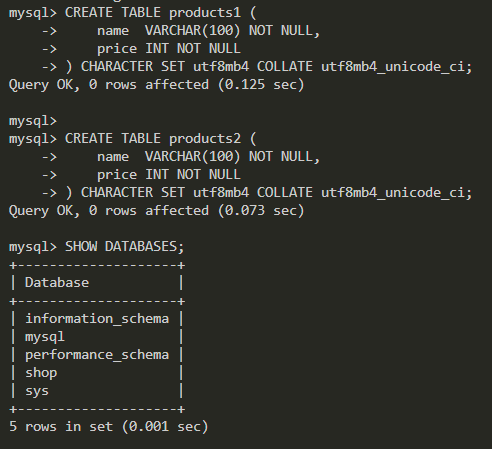

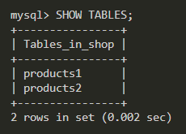

# Вставка данных

```sql
INSERT INTO products1 (name, price) VALUES
  ('Дыни', 800),
  ('Клубника', 150),
  ('Яблоки', 120),
  ('Лимоны', 200);

INSERT INTO products2 (name, price) VALUES
  ('Дыни', 800),
  ('Клубника', 150),
  ('Каштаны', 200),
  ('Хурма', 350);
```
Проверим:
```sql
SELECT * FROM products1;
SELECT * FROM products2;
```

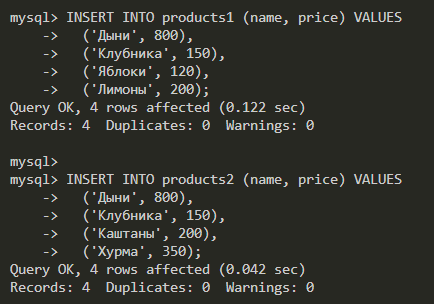

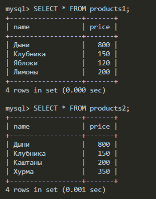

# Основные операции
### Выборка (SELECT) — фильтрация строк

**Задача:** показать товары из `products1` дороже 150.
```sql
SELECT * FROM products1 WHERE price > 150;
```

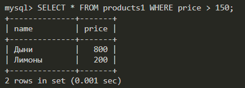

### Проекция (PROJECTION) — выбор столбцов

**Задача:** вывести только названия товаров из `products1`.

```sql
SELECT name FROM products1;
```

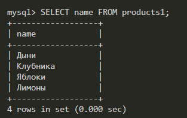

### Объединение (UNION)
**Задача:** получить единый список названий товаров из обеих таблиц (без дубликатов).
```sql
SELECT name FROM products1
UNION
SELECT name FROM products2;
```

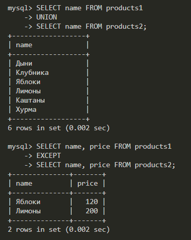

### Разность (EXCEPT / MINUS)

**Задача:** найти товары, которые есть в `products1`, но отсутствуют в `products2`.

**MySQL 8.0.31+:**
```sql
SELECT name, price FROM products1
EXCEPT
SELECT name, price FROM products2;
```

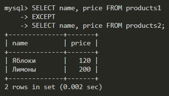

### Пересечение (INTERSECT)

**Задача:** найти товары, которые есть и в `products1`, и в `products2` (с одинаковой ценой).

**MySQL 8.0.31+:**
```sql
SELECT name, price FROM products1
INTERSECT
SELECT name, price FROM products2;
```

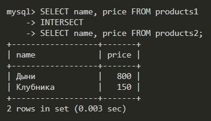

### Декартово произведение (CARTESIAN PRODUCT)

**Задача:** получить все возможные пары «товар из первой таблицы — товар из второй».
```sql
SELECT t1.name AS name1, t1.price AS price1,
       t2.name AS name2, t2.price AS price2
FROM products1 t1
CROSS JOIN products2 t2;
```

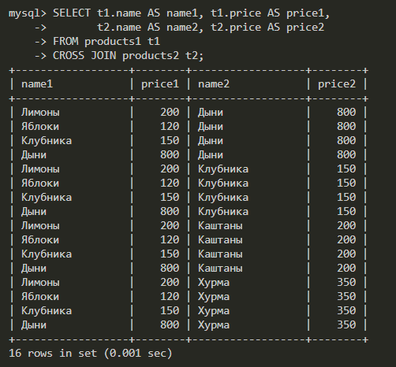

### Соединение (JOIN)

**Задача:** соединить таблицы по названию товара и показать цены из обеих таблиц.
```sql
SELECT t1.name, t1.price AS price1, t2.price AS price2
FROM products1 t1
JOIN products2 t2 ON t1.name = t2.name;
```
**Результат:**

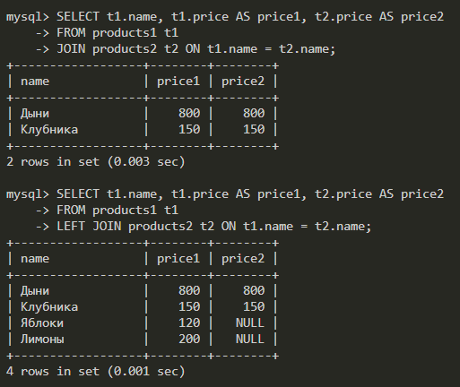

# Создание дампа

Создание дампа БД (Экспорт в `.sql` файл)

Выйти из БД
```sql
\q
```
Делаем дамп:
```shell
docker exec products-mysql mysqldump -uroot -p123 shop > dump.sql
```
или
```shell
docker exec -e MYSQL_PWD=123 products-mysql mysqldump -uroot shop > dump.sql
```
после чего в папке `products-mysql` появится текстовый файл `dump.sql`, содержимое которого можно увидеть командой
```shell
cat dump.sql
```
`.sql` файл является текстовым представлением вашей БД (текстовый SQL-скрипт). Его можно хранить как резервную копия вашей БД, из которой потом её можно восстановить


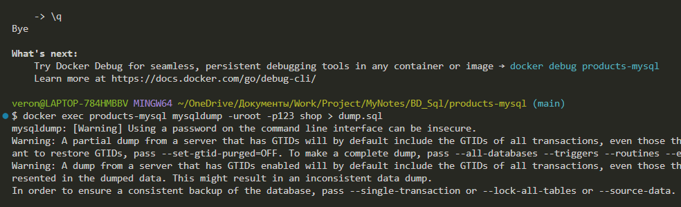

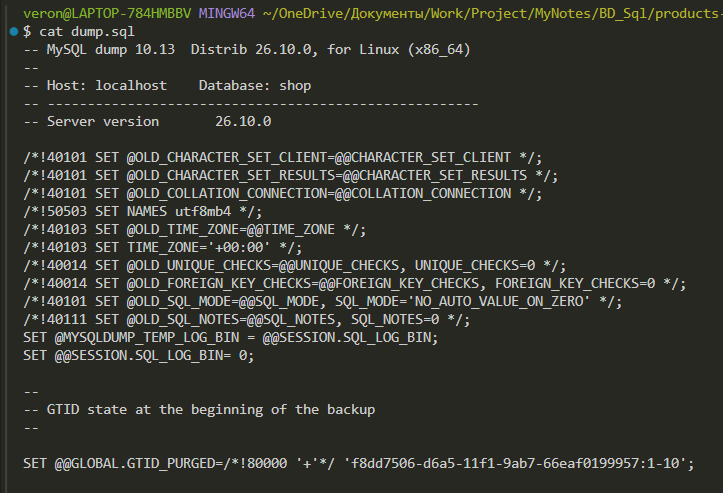

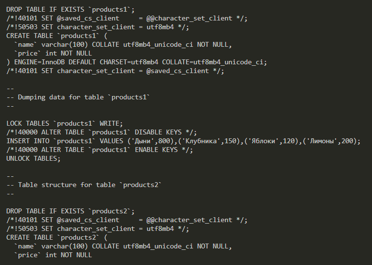

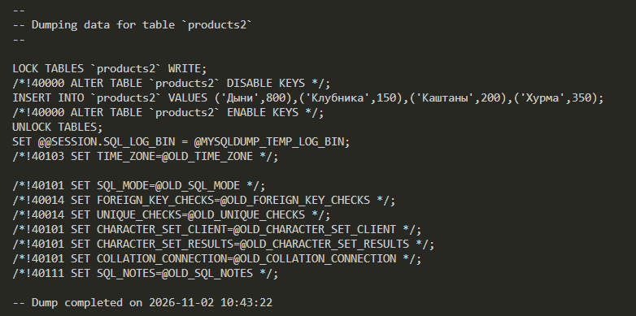

# Уборка

Снова войтив в контейнер с БД
```shell
docker exec -it products-mysql mysql --default-character-set=utf8mb4 -uroot -p
```
Проверить состояние и получить таблицы указанной БД
```sql
SHOW DATABASES;
USE shop;
SHOW TABLES;
```
Удалить указанную БД
```sql
DROP DATABASE shop;
```
Проверить результат
```sql
SHOW DATABASES;
```
Выйти из контейнера
```shell
\q
```

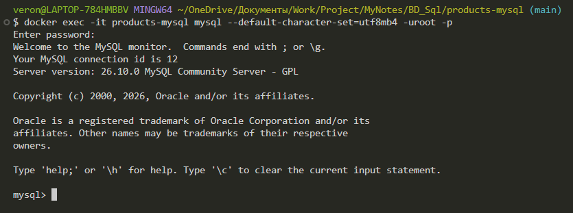

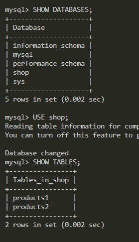

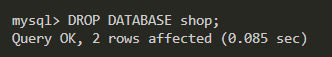

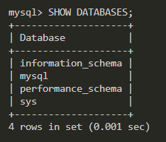

# Восстановление БД из дампа


- Проверьте, что контейнер запущен
- Проверьте, что дамп на месте и не пуст

зайти в контейнер
```shell
docker exec -it products-mysql mysql --default-character-set=utf8mb4 -uroot -p
```
Проверить результат
```sql
SHOW DATABASES;
```
выполните создание пустой БД с именем `shop`
```sql
CREATE DATABASE shop
  CHARACTER SET utf8mb4
  COLLATE utf8mb4_unicode_ci;
```
Проверить результат
```sql
SHOW DATABASES;
```
Выйти из контейнера:
```shell
\q
```
Команда импорта выполняется не внутри mysql, а в обычном терминале хоста (с игнорированием ошибок импорта):
```shell
docker exec -i products-mysql mysql -uroot -p123 --force shop < dump.sql
```
Чтобы проверить результат, нужно снова зайти в контейнер с БД
```shell
docker exec -it products-mysql mysql --default-character-set=utf8mb4 -uroot -p
```
И проверить содержимое восстановленной БД
```sql
SHOW DATABASES;
USE shop;
SHOW TABLES;
SELECT * FROM products1;
SELECT * FROM products2;
```

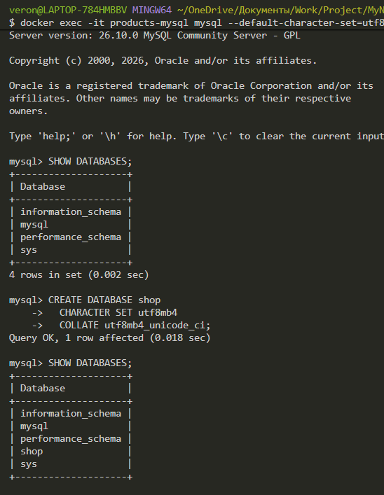

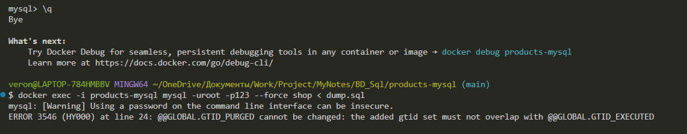

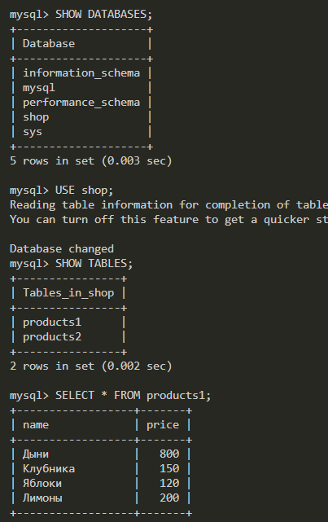

## General log

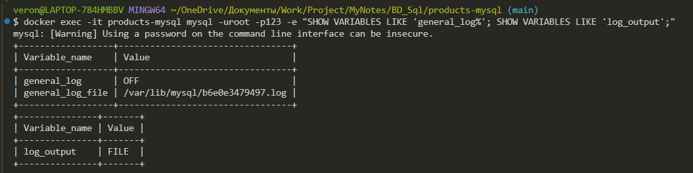

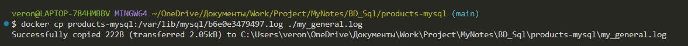